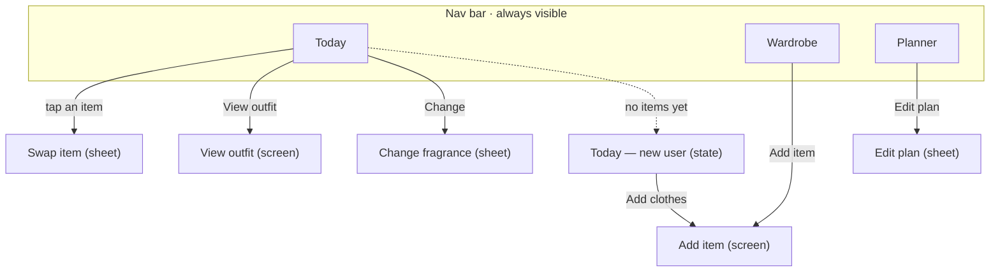

# FitCheck — Build Handoff for AI Agents

Nov 2, 2026 · Joseph Patrick Salomeo

Build FitCheck as a mobile app that picks a user's outfit and fragrance for the day from their own wardrobe, based on their plan and the weather, and tracks laundry. The Figma file is the source of truth for every screen; this doc says what to build, how it behaves, and what not to change.

## Users

Users are 16 to 67 years old, with any level of tech skill, and use the app at home in the morning, often in a hurry. Every persona below sets a requirement the build must meet.

| Persona | Who | Requirement for the build |
| --- | --- | --- |
| Josephine, 21 (primary) | Photographer; many clothes and perfumes | An outfit and a scent are ready when the app opens; the app tracks what is clean |
| Hitori, 16 | Student; anxious, no fashion sense | Every pick shows a one-line reason; few choices at a time |
| Erina, 67 | Retired model; arthritis, weak eyesight, new to phones | Body text 16 px or larger, touch targets 48 px or larger, plain words, reminders |
| Finn, 29 | Mechanic; red-green color blindness | Every item color is shown as a word, never as color alone |
| Mina, 23 | Fashion designer; her models use the app | Users create their own occasions; no fixed tag list |
| Chamber, 27 | CEO; strict dress code | Formality is a fixed scale (Casual, Smart casual, Formal); polished, neutral look |
| Joseph, 20 | Student in the Philippines; weather changes a lot | Fragrance is matched to temperature and humidity |

## Screens

The build has 4 main screens and 5 overlays. The **Mobile prototype** page in Figma holds the final version of each; read sizes, spacing and copy from there with the Figma MCP (`get_design_context` on the node), not from the older v2 or revision pages. Frames are 360 × 800.

| Screen | Type | What it does | Figma node |
| --- | --- | --- | --- |
| Today | Main tab | Week strip, weather chip, laundry notice, Outfit of the day (3 items, reason line, per-item swap badge, Wear this, Swap all, View outfit), Fragrance of the day (Change) | [115:44](https://www.figma.com/design/leBVZp8eURCGW8T82kjvH8/FitCheck?node-id=115-44) |
| Today — new user | Main tab, empty state | Checklist (top, bottom, shoes), Add clothes, optional Add a fragrance | [115:470](https://www.figma.com/design/leBVZp8eURCGW8T82kjvH8/FitCheck?node-id=115-470) |
| Wardrobe | Main tab | Category filter chips, item count, 2-column item grid with laundry badge, Add item button | Mobile prototype page |
| Planner | Main tab | Month calendar, plan card for the selected day, Edit plan | Mobile prototype page |
| Swap item | Bottom sheet | Clean items of one category that fit the day's plan; pick one | Mobile prototype page |
| View outfit | Full screen | Every piece large, with full name, color, formality and laundry status; Wear this | Mobile prototype page |
| Change fragrance | Bottom sheet | User's fragrances sorted by fit for today's weather, each with a reason | Mobile prototype page |
| Add item | Full screen form | Photo, name, color, category, occasion chips (+ New), formality, laundry tracking, wash-after count | Mobile prototype page |
| Edit plan | Bottom sheet | Occasion chips (+ New), repeat (Once, Every &lt;weekday&gt;, Custom), Save plan | Mobile prototype page |

The file also has a **Presentation** page and a **tests** page; ignore both for the build.

## Screen map

Every overlay closes back to the screen that opened it: X, its confirm button, or a tap outside a sheet. The new-user state is Today with no items; its Add clothes button opens Add item.

## Data model

All data belongs to one user. Occasions are user-defined; formality is a fixed enum. Field names are a suggestion.

| Entity | Key fields | Notes |
| --- | --- | --- |
| ClothingItem | `id, name, colorName, category (top, bottom, shoes), formality (casual, smartCasual, formal), occasionIds[], photo?, laundryStatus, tracksLaundry, washAfterWears (1–3), wearsSinceWash` | `colorName` is required text, shown on every view of the item |
| Fragrance | `id, name, scentNotes?, weatherFit (temperature band, humidity band), photo?` | Bands drive the weather ranking |
| Occasion | `id, name, isDefault` | Seed with School, Work, Church, Date; user adds more with + New |
| Plan | `id, date, occasionId, repeat (once, weekly on weekday, custom), heldItemIds[]` | Today reads the occasion for its date from here |
| OutfitPick | `date, topId, bottomId, shoesId, fragranceId, reason, status (suggested, worn)` | One per day; Wear this sets `worn` |
| UserSettings | `location, reminders on/off, theme (light, dark)` | Location feeds the weather |

Laundry status has 4 values, each shown with an icon and a word:

| Status | Set when | Can be picked for an outfit |
| --- | --- | --- |
| Clean | New item, or the user marks it washed | Yes |
| Worn | Worn, but `wearsSinceWash` < `washAfterWears` | Yes |
| To wash | `wearsSinceWash` reaches `washAfterWears` | No |
| Reserved | Held by a future Plan | Only on that plan's day |

## Core logic

The first version uses simple, explainable rules, not machine learning; every pick must produce a reason the user can read.

1. **Outfit of the day**
   1. Find today's occasion from the Plan; with no plan, use the user's most common occasion.
   2. Candidates per category = items with that occasion and status Clean or Worn (Reserved only if held for today).
   3. Pick one top, one bottom and one shoes; prefer items worn least recently and a matching formality across the three.
   4. Fewer than one candidate in any category → show the new-user empty state for that category.
2. **Swap one item** — open the sheet with the other candidates of that category (same filter as step 1.2); the current pick is listed first and marked.
3. **Swap all** — rerun step 1 and exclude today's current pieces.
4. **Fragrance of the day** — rank the user's fragrances by how well their temperature and humidity bands fit today's weather; top one is the pick, the Change sheet lists all in that order.
5. **Wear this** — set OutfitPick to worn, add 1 to `wearsSinceWash` on each piece, move pieces that reach `washAfterWears` to To wash.
6. **Evening reminder** (planned) — if the day ends with no Wear this, ask "Did you wear this?" with Yes and No; Yes runs step 5.
7. **Plans** — saving a plan holds its items as Reserved until that day; the laundry notice on Today warns when a held item is To wash before its day.

Reason text is one short line built from the inputs used, for example "Fits your School plan and a warm 27° day." and "27° and humid, so a light, fresh scent."

## Design system

Use only semantic tokens in code, never raw hex, so Light and Dark mode switch together. Values below come from the Figma variables (collections Color, Dimension); the Figma file stays the source of truth.

| Token | Light | Dark |
| --- | --- | --- |
| bg/canvas | #F6F6F5 | #0F0F0E |
| bg/surface | #FFFFFF | #191918 |
| bg/subtle | #EDEDEC | #2C2C2A |
| bg/pressed | #DEDEDC | #454542 |
| bg/accent | #3448D6 | #98A9FF |
| bg/accent-subtle | #EEF1FF | #1A2363 |
| bg/success-subtle | #DCF2E3 | #0F3520 |
| bg/warning-subtle | #FBEFD0 | #3D2900 |
| bg/danger-subtle | #FCE4E1 | #4F140F |
| text/primary | #0F0F0E | #F6F6F5 |
| text/secondary | #5E5E5A | #A1A19D |
| text/on-accent | #FFFFFF | #10163F |
| text/accent | #3448D6 | #98A9FF |
| text/success | #1E6B3C | #86D3A3 |
| text/warning | #7D5200 | #F0C46A |
| text/danger | #A42D22 | #F5A49B |
| border/subtle | #DEDEDC | #2C2C2A |
| border/strong | #7A7A76 | #7A7A76 |
| border/accent | #3448D6 | #98A9FF |

Icon tokens (icon/primary, icon/accent and so on) use the same values as the matching text tokens.

- **Type:** Plus Jakarta Sans only. Display 32 Bold, Headline 24 Bold, Title 18 SemiBold, Body 16 Regular, Body small 14 Regular, Label 16 SemiBold, Label small 14 SemiBold, Caption 12 SemiBold. Nothing under 12.
- **Space:** 4-point scale (2, 4, 8, 12, 16, 20, 24, 32, 40, 48). Screen margin 16, card padding 16.
- **Radius:** sm 8, md 12, lg 16, xl 20, full 999.
- **Size:** touch target 48; icons 16, 20, 24; stroke 1, focus ring 2.
- **Elevation:** cards are flat with a 1 px border/subtle; shadows only on things that float (sheets, FAB).
- **Components** (Figma page FitCheck v2 → Components): Button (Primary, Secondary, Tertiary), Icon button, FAB, Chip, Switch, Segmented control, Text field, Photo picker, Week strip, Day cell, Calendar cell, Item tile, Item card, Outfit card, Fragrance card, Plan card, Tag, Laundry badge, Weather chip, Inline notice, Top bar, Nav bar, Option row (on the revision page). Build each once and reuse it.

## UX rules

These rules come from the user research and must not be dropped to save time.

| Rule | In the build | For |
| --- | --- | --- |
| Never use color alone | Item colors as words; laundry status as icon + word; selected rows have a border and a check | Finn |
| Explain why | Every outfit and fragrance pick shows a one-line reason | Hitori |
| Big and readable | Body 16, minimum 12; every tap target at least 48 × 48; text pairs pass WCAG AA (4.5:1) | Erina |
| Status in place | Laundry and plan warnings are inline notices on the page, never pop-ups | Josephine |
| Say what it does | Buttons name the action: Wear this, Use this top, Save plan; never OK | Hitori, Erina |
| One accent | Cobalt marks the main action only; one primary button per screen | Everyone |
| Reach with either thumb | The main action on Today is full width; no left/right-hand setting | Everyone |
| Long names | Item and fragrance names show up to 2 lines, then …; full names in View outfit and item detail | Everyone |
| No theme | Neutral, platform-neutral look; the user's clothes bring the color | Everyone |

## Stack

The suggested stack is Flutter with Firebase, because the team already knows it; change it only if the owner agrees.

| Layer | Suggestion | Why |
| --- | --- | --- |
| App | Flutter (Dart), Material 3 widgets themed with the tokens above | One codebase for Android and iOS; team has built a FlutterFire app before |
| Components | Own widgets per Figma component; `shadcn_ui` or `forui` only as a starting style | The look must match Figma, not a library default |
| Auth | Firebase Authentication (email or Google) | Per-user data |
| Data | Cloud Firestore, one collection per entity under the user | Fits the data model; works offline |
| Photos | Firebase Storage | Item and fragrance photos |
| Weather | A free forecast API such as Open-Meteo (check its terms before release) | Temperature and humidity for the fragrance pick |
| Reminders | Local notifications | Evening "Did you wear this?" and laundry warnings |

Put tokens in one theme file (colors per mode, text styles, spacing, radius) so screens never use raw values.

## Milestones

Build in this order; each milestone ends when its checks pass on a real phone in Light and Dark mode.

1. **Foundation** — theme file with all tokens and text styles; Nav bar with Today, Wardrobe, Planner; Auth.
   - [ ] Every color in the app comes from a token; switching mode changes every screen
   - [ ] Body text is 16 and nothing is under 12
2. **Wardrobe** — Add item form, item grid, filter chips, laundry badges, Firestore and photo upload.
   - [ ] An item cannot be saved without a name, a color and a category
   - [ ] Users can add their own occasion with + New
   - [ ] Names longer than 2 lines end with …
3. **Today** — outfit pick, reason line, per-item swap sheet, Swap all, Wear this, View outfit, new-user empty state.
   - [ ] Every pick shows a reason
   - [ ] Only Clean or Worn items (or items held for today) appear as picks and in the swap sheet
   - [ ] Wear this updates laundry counts and statuses
   - [ ] A new user with no items sees the checklist, not an empty card
4. **Fragrance** — fragrance list, weather fetch by location, ranking, Change sheet.
   - [ ] The order in the Change sheet matches today's weather, each row with a reason
5. **Planner** — month calendar, plan card, Edit plan sheet with occasion and repeat, Reserved status.
   - [ ] Today's reason line shows the planned occasion
   - [ ] A held item that is To wash before its day shows a laundry notice on Today
6. **Reminders and polish** — evening reminder, accessibility pass.
   - [ ] Every tap target is at least 48 × 48
   - [ ] Every text pair passes WCAG AA
   - [ ] Screen reader reads each item's name, color and status

## Open questions

Ask the owner before building these; the designs do not answer them yet.

- [ ] Onboarding: the planned 3–4 steps (occasions, first items, fragrances, location) have no screens yet.
- [ ] Item detail and edit screen: not designed.
- [ ] Color names: typed by the user only, or suggested from the photo?
- [ ] Accessories: in scope, or only top, bottom, shoes and fragrance?
- [ ] Fragrance weather bands: who sets them, the user or a preset per scent type?
- [ ] Dark mode screens exist only for v2 Today; check the rest against the dark tokens.

## Links

- [FitCheck Figma file](https://www.figma.com/design/leBVZp8eURCGW8T82kjvH8/FitCheck) — pages: FitCheck v2 (foundations and components), FitCheck v3 — Today revision (design notes), Mobile prototype (final screens)
- [Clickable prototype](https://www.figma.com/proto/leBVZp8eURCGW8T82kjvH8/FitCheck?node-id=115-44&starting-point-node-id=115%3A44)
- Project docs: PACT analysis (Act 2) and persona profiles, in the CMSC 134 project
